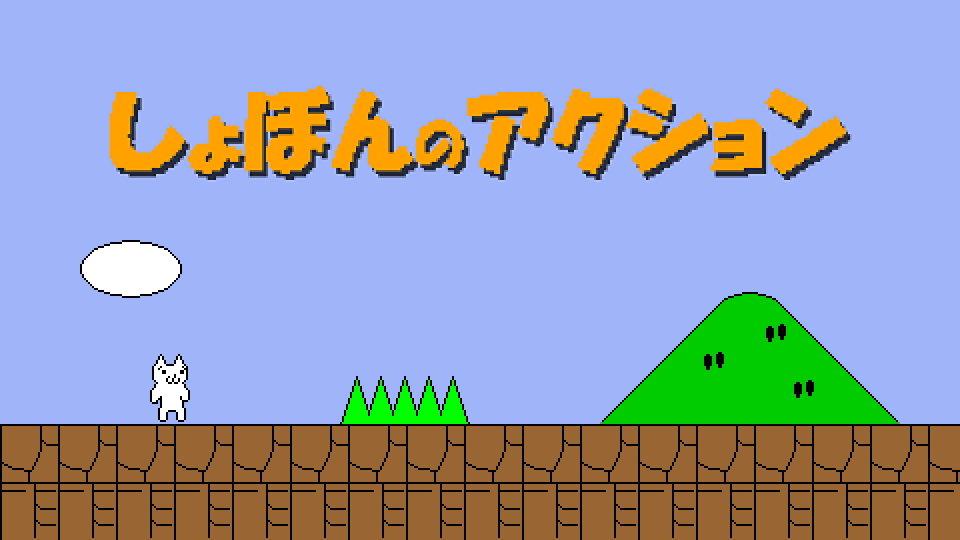

# Syobon Action (Cat Mario) for PlayStation 5



A native PS5 homebrew port of [Syobon Action](https://en.wikipedia.org/wiki/Syobon_Action) (しょぼんのアクション), also known as Cat Mario, the deliberately unfair platformer by Chiku. It starts from the home screen like any other title, as `PPSA47402`.

The game is [OpenSyobonAction](https://github.com/akemin-dayo/OpenSyobonAction), the open-source SDL rewrite, moved from SDL 1.2 to SDL2 and packaged with [ps5-native-app-boilerplate](https://github.com/blackbearreloaded/ps5-native-app-boilerplate).

## Status

Tested on one console, firmware 13.42 with kstuff-lite and ShadowMountPlus.

- Plays from the title screen through the stages with picture, music and sound effects.
- The 480x420 picture is scaled to 1920x1080, keeping its shape.
- DualSense controls, a pause menu and a stage select.

## Install

You need a PS5 that already runs homebrew, with ShadowMountPlus (it lists titles in `/data/homebrew` on the home screen) and an FTP server.

1. Build the title (below), or take `PPSA47402.zip` from a release and unzip it.
2. Copy the `PPSA47402` folder to the console, so that it becomes `/data/homebrew/PPSA47402/`.
3. Let ShadowMountPlus rescan, then start **Syobon Action** from the home screen.

To update, close the game and replace the folder's files. Release 01.000.000 used the title ID `PPSA99310`, which another app holds in the homebrew catalog; from 01.001.000 the game is `PPSA47402`, so remove an old `/data/homebrew/PPSA99310/` folder by hand. If the home screen keeps an old icon, remove the title from the home screen and let it be added again.

## Controls

| DualSense | Keyboard | Action |
| --- | --- | --- |
| D-pad, left stick | Arrow keys | Move |
| Cross, Circle | Z | Jump |
| Square (hold) | Space | Double speed |
| Options | Enter | Start; pause and resume during a stage |
| Triangle | F1 | Back to the title (from the pause menu) |
| L1, R1 (title screen) | Page Up, Page Down | Previous and next stage |
| Create | Escape | Quit |

The stage select stays hidden until L1 or R1 is pressed on the title screen.

## Building

The build runs on Linux, WSL and macOS. It fetches the public PS5 payload SDK, zlib and the PacBrew SDL2 libraries into `.deps/` on first use.

On macOS, Homebrew's LLVM 18 and the GNU tools have to come first in `PATH`:

```bash
brew install llvm@18 coreutils gnu-sed findutils ninja pkg-config wget
export PATH="$(brew --prefix coreutils)/libexec/gnubin:$(brew --prefix gnu-sed)/libexec/gnubin:$(brew --prefix findutils)/libexec/gnubin:$(brew --prefix llvm@18)/bin:$PATH"
```

Then:

```bash
make USE_CCACHE=0
```

The title folder is `dist/PPSA47402/`, and `dist/PPSA47402.zip` holds the same folder.

The game writes a short start-up log to `/data/syobon/log.txt` when it can, or to its own `/download0/log.txt`.

## Port notes

What a native title needs beyond the original SDL 1.2 code:

- `src/DxLib.cpp` draws into a 480x420 surface and scales it into the window surface: PacBrew's SDL2 for the PS5 has a framebuffer video driver and no `SDL_Renderer`. SDL2_gfx primitives draw into the surface through a software renderer, and take colours as `0xAABBGGRR`.
- Game files are opened under `/app0/assets/`, since a title's working directory is not its folder.
- `src/ps5_compat.cpp` provides what the title's runtime lacks: `nl_langinfo`, `strcasestr` and two libc++ helpers. It also stubs the keyboard calls SDL's video driver makes (in a title `sceKeyboardInit` crashes) and serves allocations of 256 KiB and more from `mmap`, because the title's libc heap stops at about 16 MiB. `Makefile` wraps those symbols with `APP_WRAP_SYMBOLS`.
- `sce_sys/param.json` asks for 256 MiB of flexible memory.

The home-screen art in `sce_sys/` is made from the game's own sprites by `art/make.sh`. It uses [bc7enc_rdo](https://github.com/richgel999/bc7enc_rdo) for the BC7 backgrounds, in place of the template's Windows `texconv`.

The template's own documentation is in [docs/TEMPLATE.md](docs/TEMPLATE.md) and the rest of `docs/`.

## Credits and licences

- Syobon Action, its graphics and sounds: Chiku (ちく), who asks to be credited.
- OpenSyobonAction: the SDL rewrite and its later maintainers; it carries no licence of its own.
- ps5-native-app-boilerplate: BlackBearReloaded, GPL-3.0-or-later (`LICENSE`), with its third-party notices in `THIRD_PARTY_NOTICES.md`.
- SDL2 and its libraries come from [PacBrew](https://github.com/ps5-payload-dev/pacbrew-repo) under their own licences.

No Sony software or keys are included.
